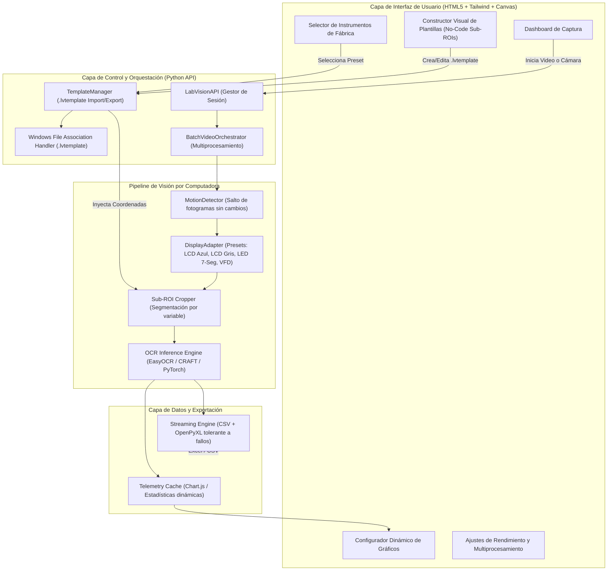
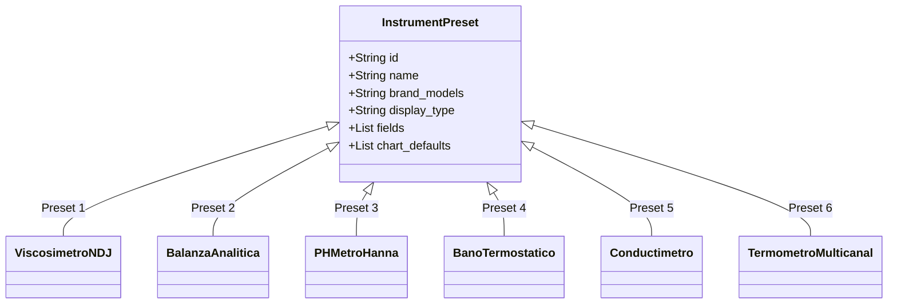

# 🗺️ Roadmap Técnico: LabVision Universal
### *De Digitalizador de Viscosímetro a Plataforma Científica Universal de Digitalización No Invasiva*

Este documento establece la hoja de ruta estratégica, la arquitectura modular, el catálogo de instrumentos de fábrica, la especificación de la extensión `.lvtemplate` y el registro de procedencia técnica/académica de todos los componentes utilizados.

---

## 🏛️ 1. Arquitectura Modular Desacoplada



---

## 🧪 2. Catálogo de Instrumentos Pre-Existentes de Fábrica

LabVision incluirá de forma nativa en la carpeta `templates/presets/` una biblioteca de instrumentos listos para usar sin configuración previa:



1. **Viscosímetro Rotacional Digital (NDJ-8S / Fungilab / Brookfield DV):**
   * *Variables:* Viscosidad ($mPa\cdot s$ / $cP$), Torque ($0-100\%$), Velocidad (RPM), Rotor (#).
   * *Display:* LCD matriz azul/cian retroiluminado.
2. **Balanza Analítica y de Precisión (Ohaus Pioneer / Mettler Toledo ME / Sartorius):**
   * *Variables:* Masa ($g$, $mg$, $kg$), Estado de Estabilidad (indicador `*` o `STABLE`), Tara.
   * *Display:* LCD gris reflectivo de 7 segmentos.
3. **pH-metro de Mesa (Hanna Instruments HI 2211 / Thermo Orion Star):**
   * *Variables:* Potencial de Hidrógeno ($pH$), Potencial Redox ($mV$), Temperatura ($^\circ C$).
   * *Display:* LCD reflectivo dual o retroiluminado.
4. **Baño Termostático / Mufla / Incubadora (Memmert / Julabo / Fisher Scientific):**
   * *Variables:* Temperatura Actual ($^\circ C$), Temperatura Setpoint ($^\circ C$), Tiempo de Ciclo ($min$).
   * *Display:* LED 7 segmentos de alto contraste (rojo / verde sobre fondo negro).
5. **Conductímetro de Laboratorio (Mettler Toledo FiveEasy / Hanna HI 2300):**
   * *Variables:* Conductividad ($\mu S/cm$, $mS/cm$), TDS ($ppm$, $mg/L$), Temperatura ($^\circ C$).
   * *Display:* LCD segmentado con selector de prefijo de unidad.
6. **Termómetro Digital / Termocupla Multicanal (Fluke / Sper Scientific):**
   * *Variables:* Canal 1 ($T_1$), Canal 2 ($T_2$), Diferencial ($\Delta T$).
   * *Display:* LCD multifunción de alta velocidad.

---

## 📁 3. Especificación Oficial de la Extensión `.lvtemplate`

La extensión oficial **`.lvtemplate`** (*LabVision Template Package*) será un archivo JSON estandarizado y firmado que permitirá compartir instrumentos entre laboratorios y equipos con un simple clic.

### A) Estructura del Archivo `.lvtemplate`:
```json
{
  "$schema": "https://labvision.org/schemas/v1/template.json",
  "lvtemplate_version": "1.0",
  "metadata": {
    "template_id": "hanna_hi2211_dual_channel",
    "name": "pH-metro Hanna HI 2211 (pH + Temp)",
    "description": "Plantilla calibrada para pantalla dual de pH y temperatura",
    "author": "NachoFari",
    "institution": "Laboratorio de Química y Procesos",
    "created_at": "2026-10-28T13:30:00Z",
    "compatible_hardware": ["Hanna HI 2211", "Hanna HI 2210"]
  },
  "display_profile": {
    "type": "lcd_reflective",
    "preprocessing": {
      "grayscale": true,
      "clahe": false,
      "threshold_mode": "otsu_adaptive",
      "invert_polarity": false,
      "noise_kernel_size": 3
    }
  },
  "sub_rois": [
    {
      "id": "ph",
      "display_label": "pH",
      "unit": "pH",
      "coordinates_relative": { "x": 0.12, "y": 0.18, "w": 0.45, "h": 0.35 },
      "data_type": "float",
      "decimal_places": 2,
      "valid_range": [0.00, 14.00],
      "ocr_whitelist": "0123456789.-",
      "quality_alert_on_jump": 2.5
    },
    {
      "id": "temperature",
      "display_label": "Temperatura",
      "unit": "°C",
      "coordinates_relative": { "x": 0.62, "y": 0.52, "w": 0.30, "h": 0.28 },
      "data_type": "float",
      "decimal_places": 1,
      "valid_range": [-10.0, 110.0],
      "ocr_whitelist": "0123456789.-",
      "quality_alert_on_jump": 10.0
    }
  ],
  "streaming_export": {
    "default_sample_interval_sec": 1.0,
    "csv_columns": ["Timestamp_ISO8601", "Tiempo_Relativo_s", "pH", "Temperatura_C", "Calidad_Lectura"]
  },
  "live_chart": {
    "primary_series": { "field_id": "ph", "color": "#06b6d4", "chart_type": "line" },
    "secondary_series": { "field_id": "temperature", "color": "#f59e0b", "chart_type": "line" }
  }
}
```

### B) Integración y Asociación en Windows:
* **Registro de Windows (`HKCR\.lvtemplate`):**
  El instalador Inno Setup registrará la extensión `.lvtemplate` vinculada a `LabVision.exe`.
* **Icono dedicado:** Cada archivo `.lvtemplate` tendrá su propio icono de documento de laboratorio con el matraz en el explorador de archivos.
* **Apertura automática con doble clic:** Al hacer doble clic en `pH_Hanna.lvtemplate`, Windows ejecutará:
  ```cmd
  LabVision.exe --template "C:\ruta\pH_Hanna.lvtemplate"
  ```
  abriendo la aplicación con el instrumento cargado y listo para capturar.

---

## 📜 4. Matriz de Trazabilidad de Software y Citas Académicas
*(Software Bill of Materials & Scientific Provenance)*

Para garantizar la integridad científica y cumplir con las normas de **Reproducibilidad y Ética de Revistas Q1** (Elsevier, Nature, IEEE), cada componente externo queda rigurosamente documentado con su origen, versión, licencia y cita bibliográfica oficial:

| Componente | Versión | Rol en LabVision | Origen / Repositorio Oficial | Licencia |
| :--- | :---: | :--- | :--- | :--- |
| **Python** | `3.12.9` | Intérprete base del motor científico y control | [python.org](https://www.python.org/) | PSF License |
| **PyTorch (CPU)** | `2.14.0` | Tensor backend y ejecución de redes neuronales | [pytorch.org](https://pytorch.org/) (Linux Foundation) | BSD-3-Clause |
| **EasyOCR** | `1.7.2` | Pipeline OCR de texto y números | [JaidedAI/EasyOCR](https://github.com/JaidedAI/EasyOCR) | Apache 2.0 |
| **CRAFT Text Detector** | `MLT-25k` | Detección de regiones de caracteres en pantallas | [clovaai/CRAFT-pytorch](https://github.com/clovaai/CRAFT-pytorch) | CC BY-NC-SA 4.0 |
| **OpenCV** | `4.10.0` | Preprocesamiento, filtros adaptativos, captura video | [opencv.org](https://opencv.org/) | Apache 2.0 |
| **PyWebView** | `6.2.1` | Motor de ventana nativa de escritorio con WebView2 | [pywebview.flowrl.com](https://pywebview.flowrl.com/) | BSD-3-Clause |
| **Microsoft Edge WebView2** | *Evergreen* | Renderizado del frontend HTML5/CSS3/JS | [Microsoft Edge Developer](https://developer.microsoft.com/microsoft-edge/webview2/) | Microsoft Proprietary (Free Redistributable) |
| **OpenPyXL** | `3.1.5` | Generación y streaming de hojas de cálculo Excel `.xlsx` | [openpyxl.readthedocs.io](https://openpyxl.readthedocs.io/) | MIT License |
| **Pandas** | `2.2.3` | Manipulación de series temporales y cálculo de métricas | [pandas.pydata.org](https://pandas.pydata.org/) | BSD-3-Clause |
| **Inno Setup** | `6.7.3` | Compilador del instalador autónomo de Windows | [jrsoftware.org/isinfo.php](https://jrsoftware.org/) | Inno Setup License |
| **Chart.js** | `4.4.1` | Renderizado de gráficos vectoriales interactivos | [chartjs.org](https://www.chartjs.org/) | MIT License |
| **TailwindCSS** | `3.4.1` | Sistema de diseño de interfaz de usuario | [tailwindcss.com](https://tailwindcss.com/) | MIT License |

### 📚 Citas Académicas Oficiales para el Manuscrito del Paper:

1. **Detección de Texto (CRAFT):**
   > Baek, Y., Lee, B., Han, D., Yun, S., & Lee, H. (2019). *Character Region Awareness for Text Detection*. In Proceedings of the IEEE/CVF Conference on Computer Vision and Pattern Recognition (CVPR), pp. 9365-9374.
2. **Framework de Deep Learning (PyTorch):**
   > Paszke, A., Gross, S., Massa, F., et al. (2019). *PyTorch: An Imperative Style, High-Performance Deep Learning Library*. In Advances in Neural Information Processing Systems (NeurIPS 32), pp. 8024-8035.
3. **Visión por Computadora (OpenCV):**
   > Bradski, G. (2000). *The OpenCV Library*. Dr. Dobb's Journal of Software Tools, 25(11), 120-125.
4. **Declaración de Asistencia de IA (Generative AI Disclosure):**
   > *"The software architecture, modular refactoring, and automated GUI scaffolding were developed with the assistance of Google Antigravity / Gemini 2.5. Algorithm specifications, heuristic parsers, error-checking benchmarks, and experimental validation on laboratory instruments were conceived, supervised, and verified by the authors."*

---

## 📋 5. Fases de Desarrollo Actualizadas

| Versión | Alcance Técnico | Entregables Clave |
| :---: | :--- | :--- |
| **v0.8** *(Actual)* | Estabilidad, rutas relativas, instalador `.exe` de 87 MB | `LabVision-Setup-v0.8.exe` con Viscosímetro y Balanza |
| **v0.9** | Formato `.lvtemplate` + 6 Presets de fábrica | Registro en Windows de `.lvtemplate` y biblioteca de 6 equipos |
| **v1.0** | Constructor Visual No-Code en la UI | Dibujo interactivo multi-caja en pantalla con test en vivo |
| **v1.1** | Presets de pantalla física (LCD, LED 7-seg, VFD) | Pipelines OpenCV automáticos según tecnología del display |
| **v1.2** | Multiprocesamiento paralelo de video y filtro delta | Aceleración $5\times$ a $10\times$ en el procesamiento de videos |
| **v1.3** | Gráficos configurables y suite de validación científica | Manuscrito de paper científico listo para enviar a **SoftwareX** / **HardwareX** |
